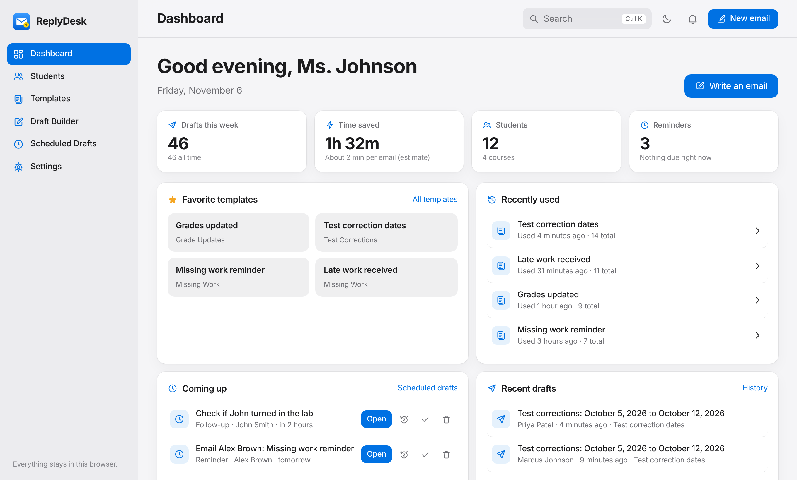
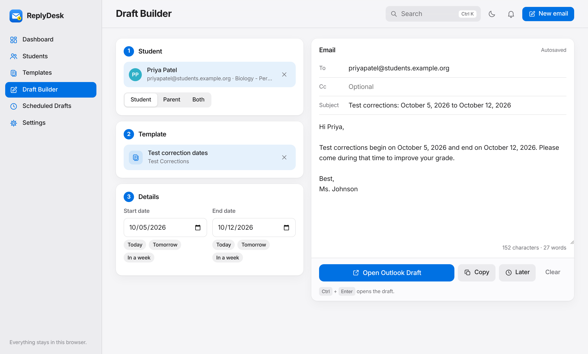
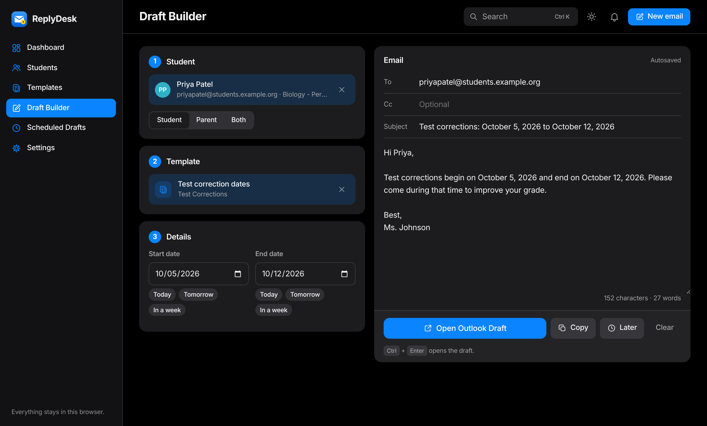
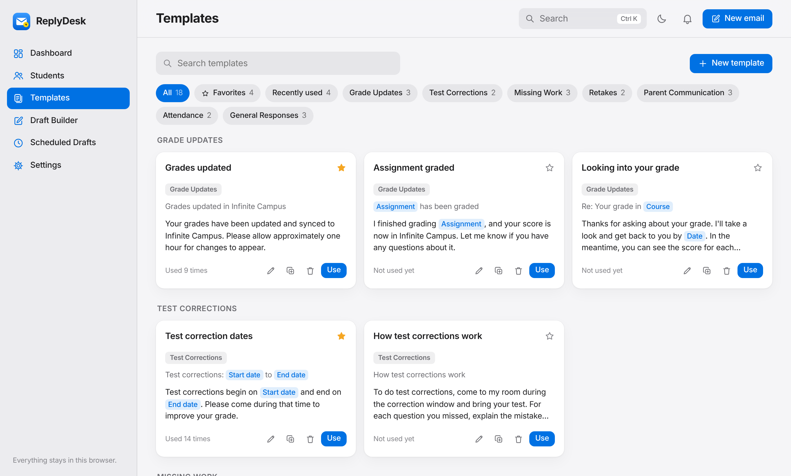
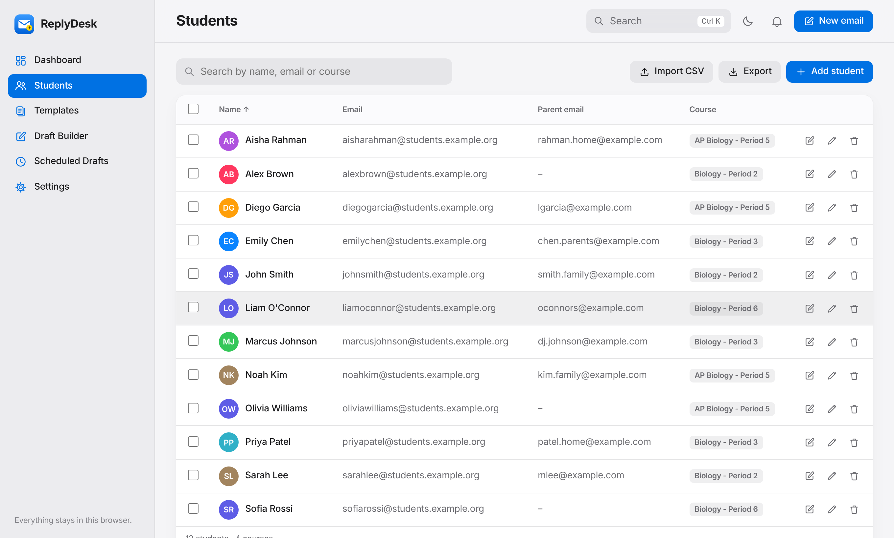

# ReplyDesk

**Answer the same student emails in seconds.** Pick a student, pick a template, open an Outlook draft, press Send.

Made by Abdur Rahman Ansar.



## Why I built it

My teacher gets a ridiculous amount of email. Every single day. And most of it is the same five questions: "Can you grade my late assignment?", "When are test corrections?", "Did you update Infinite Campus?", "Can I retake the test?", and the classic "Am I missing anything?"

So every reply went like this: find the student, find their email, dig up the last time she answered that exact question, copy, paste, fix the name, fix the dates, send. Then do it again for the next kid. And the next one.

ReplyDesk turns all of that into:

**Select student → Select template → Open Outlook Draft → Send**

The catch is that it had to run on a school computer. That means no admin password, no installing anything, no IT ticket, no "please grant this app access to your Microsoft account." So the whole thing is one web page that runs in the browser. No server, no login, no database. You can literally double-click `index.html`.

## What it does

- **Student roster.** Import a CSV or just paste a list of names, search it instantly, edit or remove students. Emails, parent emails and courses are all optional.
- **Name-only students.** No emails in your roster? No problem. ReplyDesk puts the student's name in Outlook's To box, and Outlook looks up their school address for you.
- **Templates.** 18 built-in ones for grades, test corrections, missing work, retakes, parents, attendance and general replies. Make your own, edit, duplicate, delete, favorite, search and sort them into categories.
- **Placeholders.** Write `{{studentName}}`, `{{startDate}}`, `{{assignmentName}}` and so on, and they fill themselves in.
- **Date pickers.** Any template with a date in it gets calendar pickers, plus Today / Tomorrow / In a week buttons. Dates come out like "October 5, 2026", not "10/5/26".
- **One-click Outlook drafts.** To, Subject and Body are already filled in. You just press Send.
- **Same reply, next student.** After you send one, keep the template and dates and swap in the next kid. Twenty students who all need the test correction dates? Twenty clicks.
- **Parents.** Parent templates go to the parent automatically. Or pick Student, Parent or Both.
- **Scheduled drafts.** Save a draft for later, set a reminder (15 minutes, 1 hour, tomorrow, or any time), or schedule a follow-up with a student.
- **Quick search.** Press Ctrl K (⌘K on a Mac), type a name, press Enter. You're writing to them.
- **The small stuff.** Favorites, recently used templates, draft history, character counter, copy button, autosave, dark mode, keyboard shortcuts, and a "time saved" counter so you can feel good about yourself.
- **Installs like an app.** Pin it to the desktop or taskbar and it opens in its own window, not as tab number 47.

| | |
| --- | --- |
|  |  |
|  |  |

## Getting started

**Fastest way:** open the link → install it as an app → done. Details below.

### Option 1: Just open it (works anywhere)

1. Click the green **Code** button on this page, then **Download ZIP**.
2. Unzip it somewhere you'll find it again, like Documents.
3. Double-click `index.html`.

That's it. It opens in your browser and saves everything there. Bookmark it so you don't have to go digging through folders every morning.

### Option 2: Just use the link (recommended)

This is the easy way. ReplyDesk is already up and running here:

👉 **https://cy6er-knight.github.io/replydesk/**

Open it and you're good. No admin password, no account, no installing anything, no server, no database, no Microsoft permissions. Nothing to set up.

### Install it as an app (also recommended)

If you want ReplyDesk to act like a real app instead of living in tab number 47:

**Google Chrome**

1. Open https://cy6er-knight.github.io/replydesk/
2. Click the install icon at the right end of the address bar. Don't see it? Click **⋮ → Cast, save, and share → Install page as app**.
3. Click **Install**.

**Microsoft Edge**

1. Open https://cy6er-knight.github.io/replydesk/
2. Click **⋯ (Settings and more) → Apps → Install this site as an app**.
3. Click **Install**.

There's also an **Install app** button at the bottom of ReplyDesk's sidebar that does the same thing.

Why bother installing it?

- ✅ Opens in its own window, not a browser tab
- ✅ Shows up in the Start menu
- ✅ Pin it to the taskbar or desktop (right-click the icon → **Pin to taskbar**)
- ✅ Works offline once it's installed
- ✅ Still no admin permissions needed

> Your roster and templates are saved on your own computer, not on GitHub. GitHub just hosts the app itself. More on that in [Privacy](#privacy).

### Want your own copy?

If you want to change things up or host your own version:

1. Fork this repo.
2. Go to **Settings → Pages**.
3. Under **Branch**, pick `main` and `/ (root)`, then click **Save**.
4. Wait a minute or two for it to deploy.
5. Open `https://your-username.github.io/replydesk/`.

Now you've got your own version that you can change however you want.

## Setting it up

1. **Settings:** type your name the way students see it (like "Ms. Johnson"). It goes in every signature.
2. **Students:** click **Import CSV** (or drag the file onto the page), or click **Paste names** and paste a list straight from Infinite Campus. Want to try it first? Click **Try the sample roster**.
3. **Open drafts in:** this one matters on school computers. Read the next section. (It starts on Outlook on the web.)

### Outlook app or Outlook on the web?

ReplyDesk opens drafts with a normal link, so it never needs any Microsoft permissions. There are two kinds:

- **Outlook app** uses a `mailto:` link. It opens the Outlook program, but only if Outlook is set as the computer's default email app. If you click Open Outlook Draft and nothing happens, that's why.
- **Outlook on the web** opens `outlook.office.com` in a new tab with the draft ready. This works on any computer where you can sign in to your school email, Chromebooks included. **If you're not sure, pick this one.**

There's also a Gmail option for Google schools.

## The roster

### Paste it

Click **Paste names** on the Students page. Copy the roster out of Infinite Campus, Excel or Google Sheets and paste it in, or just type one name per line. "Smith, John" turns into John Smith, and courses get picked up if there's a column for them.

### Name-only students (no emails)

Lots of schools use student emails like `20481736@school.org` that you can't guess from a name. You don't need them. If your school's Outlook already knows every student (you can type a name in To and it finds them), ReplyDesk just puts the student's name in the To box and Outlook fills in the address.

If Outlook doesn't turn the name into an address on its own, click the name in To and pick the student from the list. Or go to **Settings → Students with no email → Leave To empty**. Then the To box is left blank, the name is copied for you, and you paste it in and pick the student.

This works for anyone, not just people on your roster. Type a name straight into the To box in the Draft Builder (like `Jane Doe`, or `Jane Doe, Mark Lee` for two people) and it goes to Outlook the same way.

### Or import a CSV

Only **Name** is required. Export from Infinite Campus, Excel or Google Sheets, then save as CSV.

```csv
Name,Email,Parent Email,Course
John Smith,johnsmith@student.org,smith.family@example.com,Biology - Period 2
Sarah Lee,sarahlee@student.org,,Biology - Period 2
"Garcia, Diego",diegogarcia@student.org,lgarcia@example.com,AP Biology - Period 5
```

It's pretty forgiving about this:

- Column names like `Student Name`, `Student Email`, `Guardian Email`, `Class` or `Period` all work. So do separate `First Name` and `Last Name` columns.
- "Garcia, Diego" gets flipped to "Diego Garcia" automatically.
- No Email column? Everyone comes in as name-only. A row with a broken email (like `jsmith@`) gets skipped, and it tells you which ones.
- Importing again updates students who are already there instead of making duplicates. Import a file with emails later and it fills them in. Or pick **Replace my roster** to start fresh.

There's a full example in [`sample_students.csv`](sample_students.csv). All the names in it are made up.

## Placeholders

Put any of these in a template's subject or message:

| Placeholder | Becomes | Filled in by |
| --- | --- | --- |
| `{{studentName}}` | John Smith | The student you picked |
| `{{firstName}}` | John | The student you picked |
| `{{teacherName}}` | Ms. Johnson | Settings |
| `{{course}}` | Biology - Period 2 | The roster, or your default course |
| `{{date}}` | October 5, 2026 | A date picker |
| `{{startDate}}` | October 5, 2026 | A date picker |
| `{{endDate}}` | October 12, 2026 | A date picker |
| `{{assignmentName}}` | Unit 3 Test | A text box |

You can also make up your own. `{{labName}}` gets a text box, and anything ending in "Date" (like `{{dueDate}}`) gets a date picker. If you forget to fill one in, ReplyDesk tells you before it opens the draft, so no student ever gets an email that says "Hi {{firstName}}".

Greetings and signatures are added for you (change them in Settings). So a template only needs the part that actually changes:

```
Test corrections begin on {{startDate}} and end on {{endDate}}. Please come during that time to improve your grade.
```

turns into:

```
Hi Priya,

Test corrections begin on October 5, 2026 and end on October 12, 2026. Please come during that time to improve your grade.

Best,
Ms. Johnson
```

## Changing the default templates

The built-in templates live in [`templates.json`](templates.json). On GitHub Pages, edit that file and new users start with your templates instead. You can also import a templates file any time from **Settings → Import templates.json**. Templates you make in the app are saved in your browser, so you don't have to touch the file at all.

## Reminders, honestly

Without a server, nothing can run while the page is closed. So:

- Reminders pop up while ReplyDesk is open (in any tab, or as an installed app).
- If it was closed when a reminder came due, you'll see it the next time you open it.
- Turn on browser notifications in Settings to get a pop-up even when you're in another tab. Some schools block these. If yours does, the reminders still show up inside ReplyDesk.

Same deal for scheduling: ReplyDesk can't send email at a set time, because that would need Outlook permissions. What it can do is remind you at that time with the draft ready to go, which is one click away from the same thing.

## Privacy

It's student data, so I took this part seriously.

ReplyDesk saves your roster, templates, drafts, reminders and settings in your browser, on your own computer. That's it. It doesn't upload student info, doesn't use a database, doesn't send anything to a server, doesn't need an account, and doesn't track anybody.

- **Nothing leaves your computer.** There's no server, no analytics, no tracking. The roster and templates are saved in your browser's local storage on that one computer.
- **Don't commit your real roster to GitHub.** The `.gitignore` in this repo ignores CSV files (except the sample) for exactly this reason. Student names and emails don't belong in a public repo.
- **On a shared computer,** use **Settings → Clear all data** before you leave. Use **Export backup** to move your stuff to another computer.
- Everything you type gets escaped before it's shown on the page, so a weird student name can't run code. Exported CSVs are protected against spreadsheet formula injection too.

## How it works (the nerdy part)

It's plain HTML, CSS and JavaScript. No frameworks, no build step and no npm packages, so there's nothing to install and nothing to break.

```
index.html             the page: sidebar, the six views, dialogs, icons
style.css              all the styling, with light and dark color tokens
script.js              everything else (sections are labeled at the top)
templates.json         the default templates and categories
sample_students.csv    a made-up roster to try it with
manifest.webmanifest   app name and icons, so it can be installed
sw.js                  service worker: offline support and notifications
icons/                 app icons
docs/                  screenshots for this README
```

Some details, if you're curious:

- **Routing:** each page is a hash URL (`#/students`, `#/builder`), so the back button works and it runs the same from a folder or a website.
- **Storage:** a small wrapper around `localStorage` that never crashes the app if storage is full or blocked. Each kind of data has its own key (`replydesk.students`, `replydesk.templates`, and so on).
- **Placeholders:** one regex finds every `{{placeholder}}`. Known ones fill in automatically, date ones get `<input type="date">`, and anything left over stays visible so you can't miss it.
- **Opening drafts:** `mailto:` links for the Outlook app, and Outlook's compose deep link for the web version. Line breaks are encoded as `%0D%0A` so Outlook keeps them. ReplyDesk warns you if a `mailto:` link gets long enough that some Outlook versions might cut it off.
- **Why the default templates are in two places:** browsers don't let a page opened from a folder (`file://`) read other files, so `templates.json` is also copied into `script.js`. On a real website, ReplyDesk reads `templates.json` first.
- **Offline:** the service worker loads fresh files when you're online and falls back to its saved copy when you're not.
- **Multiple tabs:** if you have ReplyDesk open twice, a change in one shows up in the other.

## Keyboard shortcuts

| Shortcut | What it does |
| --- | --- |
| Ctrl K / ⌘K | Search students, templates and pages |
| / | Same thing |
| ↑ ↓ Enter | Move through results and pick one |
| Ctrl Enter / ⌘ Enter | Open the draft (in the Draft Builder) |
| Esc | Close whatever's open |

## Ideas for later

- Bulk email: one template, BCC a whole period
- A "this student already got this email this week" warning
- Template variables per course

Got a better idea? Open an issue.

## License

MIT © 2026 Abdur Rahman Ansar. See [LICENSE](LICENSE). Use it, change it, share it with every teacher you know, just keep my name on it.

Peace ✌️\
-Abdur :]
